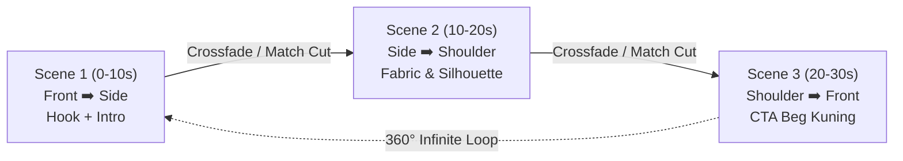
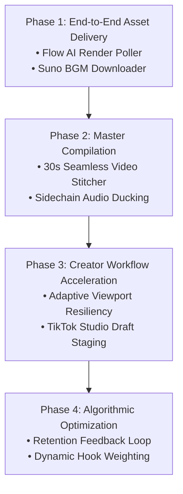

# 🚀 Gemini Flow — Architecture & Pipeline Upgrade Proposals
================================================================

This document details prioritized architectural, automation, and algorithmic upgrades for the **Gemini Flow** autonomous TikTok Shop product promotion engine. 

Each proposal outlines the **problem statement**, **technical design**, **implementation plan**, and **impact on end-to-end conversion**.

---

## 📋 Table of Upgrades

| # | Proposal | Priority | Complexity | Target Area |
|---|---|---|---|---|
| **1** | [Flow AI Render Watcher & Video Auto-Downloader](#1-flow-ai-render-watcher--video-auto-downloader) | 🔴 High | Medium | Video Generation (`automate_flow.py`) |
| **2** | [Suno AI Audio Harvester & Audio Ducking Engine](#2-suno-ai-audio-harvester--audio-ducking-engine) | 🔴 High | Medium | BGM Automation (`create_suno.py`) |
| **3** | [30s 360° Seamless Video Stitcher & Transcoder](#3-30s-360-seamless-video-stitcher--transcoder) | 🟡 Medium | Low | Post-Processing (FFmpeg) |
| **4** | [Adaptive Multi-Window Responsive Resilient Locators](#4-adaptive-multi-window-responsive-resilient-locators) | 🟡 Medium | Low | Browser Automation (Playwright CDP) |
| **5** | [TikTok Shop Affiliate Auto-Draft Staging](#5-tiktok-shop-affiliate-auto-draft-staging) | 🟢 Low | High | TikTok Upload Automation |
| **6** | [AI Hook Performance & Retention Feedback Loop](#6-ai-hook-performance--retention-feedback-loop) | 🟢 Low | Medium | Analytics & Database Sync |

---

## 1. Flow AI Render Watcher & Video Auto-Downloader

### Problem Statement
`automate_flow.py` successfully injects frame pairs and lip-sync prompts for Scene 1, Scene 2, and Scene 3, then clicks "Start generation". However, because Google Flow AI (Veo / Omni Flash) takes 60–120 seconds per 10s clip to render, the agent currently leaves the videos rendering on the canvas. The user must manually wait, right-click, and download the three `.mp4` video files.

### Technical Design
Build a background poller module (`poll_flow_renders.py` or integrated into `automate_flow.py --watch`):
1. **CDP Canvas Observer:**
   - Intercept WebSocket network frames or poll the canvas project cards: `div[data-card-id]`, `div.video-render-card`.
   - Monitor the progress ring / rendering indicator state (`aria-label='Generating...'` -> `video[src]`).
2. **Video Asset Extraction:**
   - Once the `<video>` element inside the card renders with an active blob/source URL or the download button becomes active (`button[aria-label='Download video']`):
   - Programmatically trigger the download or stream the raw `.mp4` buffer.
   - Save to:
     ```
     output/<timestamp>/videos/scene_1_front_to_side.mp4
     output/<timestamp>/videos/scene_2_side_to_shoulder.mp4
     output/<timestamp>/videos/scene_3_shoulder_to_front.mp4
     ```
3. **Supabase Video CDN Upload:**
   - Automatically push the rendered videos to Supabase Storage bucket `gemini-flow-videos`.
   - Store public video CDN URLs in `gemini_flow_generations.video_urls`.

### Value & Impact
Eliminates the only remaining manual pause point in video generation. The pipeline delivers final ready-to-watch `.mp4` files directly to disk and cloud.

---

## 2. Suno AI Audio Harvester & Audio Ducking Engine

### Problem Statement
`create_suno.py` successfully initiates 2 instrumental BGM tracks in `suno.com/create` in Brave. However, the finished audio remains in Suno's cloud library. TikTok videos require the BGM to be mixed into the video audio stream at a soft volume (-18 dB to -22 dB) beneath the Flow AI spoken Malay lip-sync voiceover.

### Technical Design
1. **Audio Poller (`sync_suno_audio.py`):**
   - Poll the latest created clip card under Suno's "Today" section until the audio waveform replaces the loading spinner.
   - Suno clip audio URLs are directly accessible from the DOM / network tab: `https://cdn1.suno.ai/<clip-uuid>.mp3`.
   - Download the chosen instrumental track to `output/<timestamp>/bgm.mp3`.
2. **Sidechain Audio Ducking Engine (FFmpeg):**
   - Using FFmpeg's `sidechaincompress` or `amix` filter:
     ```bash
     ffmpeg -i flow_video.mp4 -i bgm.mp3 -filter_complex \
     "[1:a]volume=0.18[bgm];[0:a][bgm]amix=inputs=2:duration=first[aout]" \
     -map 0:v -map "[aout]" -c:v copy -c:a aac -b:a 192k output_mixed.mp4
     ```
   - Automatically dips BGM volume during spoken dialogue and swells gently during brief pauses.

### Value & Impact
Produces complete, broadcast-quality audio mix with pristine spoken dialogue and warm background vibe.

---

## 3. 30s 360° Seamless Video Stitcher & Transcoder

### Problem Statement
The user currently receives three separate 10-second clips. While designed to flow sequentially (Front ➡️ Side ➡️ Shoulder ➡️ Front), viewers and TikTok algorithm prefer a single continuous 30-second video with seamless transitions.

### Technical Design
Create `stitch_scenes.py` using lossless FFmpeg concatenation:


1. **Match-Cut Transition:**
   - Because Scene 1's End Frame is pixel-identical to Scene 2's Start Frame, and Scene 2's End Frame is identical to Scene 3's Start Frame, the video cuts together seamlessly without jarring morph artifacts.
2. **Loop Optimization:**
   - Scene 3 ends on Frame 1 (Front View), enabling TikTok's automatic loop replay to restart from Scene 1 without a harsh skip, driving higher video completion and retention metrics.
3. **Format Standards:**
   - Resolution: 1080x1920 (9:16 vertical)
   - Codec: H.264 High Profile, YUV420p, 30fps
   - Audio: AAC 48kHz stereo, 192 kbps

---

## 4. Adaptive Multi-Window Responsive Resilient Locators

### Problem Statement
When the user works side-by-side with split-screen windows (e.g. Brave snapped to half the desktop width), web apps like Suno, Flow AI, and Gmail automatically collapse desktop sidebars into slide-out drawers, bottom sheets, or icon rails.

### Technical Design
Standardize our automation scripts (`automate_flow.py`, `create_suno.py`, `reply_gmail.py`) with **Adaptive Geometry Layers**:
1. **Viewport Detection:**
   ```python
   # Detect if running in mobile-drawer or desktop-sidebar layout
   is_narrow_layout = await page.evaluate("() => window.innerWidth < 900")
   ```
2. **Self-Healing Selector Fallbacks:**
   - Every selector must have a primary desktop path, a secondary responsive drawer path, and a direct semantic fallback (e.g. `role='textbox'`, `aria-label`, data attributes).
3. **Overlay & Popover Dismissal Protocol:**
   - Standardized `dismiss_interfering_overlays(page)` helper to safely clear tooltips and popovers without triggering unintended navigation.

---

## 5. TikTok Shop Affiliate Auto-Draft Staging

### Problem Statement
After video generation and caption drafting, the creator must open TikTok Studio / Web Creator Portal, upload the video, paste the caption, select the product link, and tick the AIGC disclosure checkbox.

### Technical Design
Create `stage_tiktok_draft.py` using the authenticated Brave browser session:
1. Navigate to `https://www.tiktok.com/creator-center/upload`.
2. Attach the generated 30s stitched `.mp4`.
3. Fill in the TikTok caption and verified hashtags.
4. Auto-toggle **"AI-generated content"** (ensuring 100% compliance with TikTok AIGC transparency rules).
5. Leave video saved as **Draft** so the creator can do a 1-second final review before publishing.

---

## 6. AI Hook Performance & Retention Feedback Loop

### Problem Statement
Currently, `verify_hook_quality()` statically evaluates candidate hooks against 8 proven archetypes and 5 scoring criteria (Immediacy, Specificity, Social Proof, Malaysian resonance, Non-repetition). While effective, it does not yet adapt based on live performance data of previously published videos.

### Technical Design
1. **Performance Logging:**
   - Extend `gemini_flow_generations` table with post-publish metrics:
     - `views_24h`
     - `retention_2s_rate`
     - `completion_rate`
     - `gmv_generated`
2. **Dynamic Weight Tuning:**
   - Query historical top-performing hook archetypes for the specific product category (e.g., *The Flattering Silhouette* vs *The Unspoken Daily Dilemma*).
   - Feed highest-converting phrasing patterns into Step 4 ranking algorithm to continuously maximize click-through rate to the TikTok Shop yellow basket (*beg kuning*).

---

## 📌 Implementation Roadmap



*File authored: October 19, 2026*  
*Repository: `gemini-flow`*

